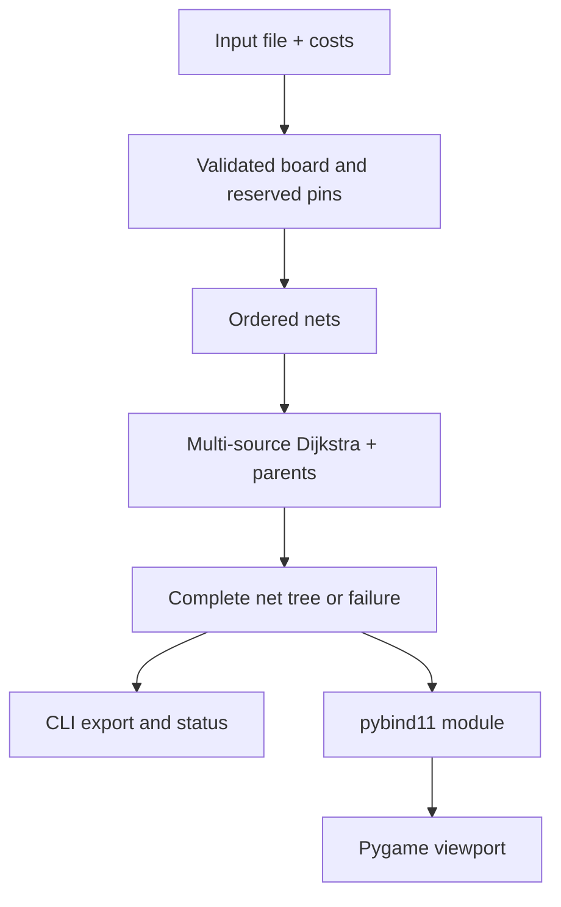

# Lee's Maze Router

A C++ two-layer VLSI maze router with weighted shortest-path search, a command-line interface, and a Python/Pygame viewer. It connects pins around obstacles and distinguishes a routed net from an unreachable one. This is physical-design routing, not network packet routing.

The original AUC CSCE 3304 team project was created by **Aly Elaswad, Mohamed Alaa, and Omar Ganna** (Spring 2025). The original report and historical fixtures remain available. The review branch adds correctness, input-safety, and reproducibility improvements; individual ownership of the original team components has not been established.

## What it demonstrates

- Two routing layers with complementary preferred directions; weighted Dijkstra search accounts for vias and nonpreferred moves.
- Deterministic net ordering by bounding-box span, pin count, then input order.
- Multi-source search attaches each additional pin to its net's existing tree. Other nets' pins and tracks remain reserved.
- Explicit predecessor tracking and per-net rollback: a failed net exports `UNROUTABLE`, with no partial tracks committed.
- Strict coordinates, bounded input and costs, 64-bit path distances, checked file operations, and a shared C++ core used by both front ends.

## Architecture



`src/functions.cpp` owns parsing and routing; `functions.hpp` defines the shared contract. `main.cpp` provides exit statuses; `binding.cpp` exposes the same implementation to `gui.py`. Grid storage is `[layer][x][y]`. Internal layers are zero-based; file coordinates use layers 1 and 2.

For a board with V = 2 × rows × columns states and E ≤ 5V edges, each attachment uses O((V+E) log V) time and O(V) search storage. The sequential net heuristic does **not** guarantee a globally optimal multi-net solution or a minimum Steiner tree. Reported cost is the sum of accepted branch costs; shared tree cells are not charged twice.

## Build and run the CLI

Requires a C++17 compiler, CMake 3.20+, and Python 3.10+ for the test harness. The CLI itself has no Python runtime dependency.

```bash
cmake -S . -B build -DCMAKE_BUILD_TYPE=Release
cmake --build build --parallel 2
./build/maze-router tests/rectangular.txt route-result.txt 10 10
ctest --test-dir build --output-on-failure
```

Windows multi-configuration generators place the executable under `build/Release/`; Linux was executed during this review. The optional final two CLI values are **via cost**, then **nonpreferred direction cost**, both defaulting to 10. Costs must be 1–1,000,000; a preferred step costs 1.

Exit statuses: **0** all nets routed; **2** valid board with one or more unroutable nets; **1** invalid input, configuration, or I/O failure. Always use a new output path: existing files and the input file are never intentionally overwritten.

## Input and output

```text
8x20
OBS (8,2)
OBS (8,3)
OBS (8,4)
netA (1,1,2)(1,18,2)(2,18,6)
netB (2,2,6)(2,5,6)
```

The first line is **rows × columns**: here `0 ≤ x < 20`, `0 ≤ y < 8`. `OBS (x,y)` blocks both layers. Net names begin with `net` and may then contain letters, digits, underscores or hyphens. Every net needs at least two distinct pins; layers must be 1 or 2. Empty lines and whitespace are accepted; unknown text, overlapping pins, obstacle/pin conflicts, and out-of-range coordinates are rejected.

Bounds: 1 MiB input, 4,096 bytes per line, 64-character net names, 100,000 cells per layer, 256 nets, 2,048 total pins. These limits constrain allocation; very congested inputs can still take substantial CPU time. Use an external time limit for untrusted batch workloads.

Each output line contains the original net name followed by its **unique connected cells**, sorted by layer/x/y. A branched tree is a cell set, not an ordered walk. Failure is explicit:

```text
netBlocked UNROUTABLE
```

CLI summaries include route status, accumulated branch cost and cell count. Historical `tests/Testcase*/output.txt` files and `src/output.txt` are preserved as legacy material, **not** correctness oracles; all nine historical inputs were accepted during review; Testcases 2 and 8 each reported one unreachable net.

## Optional GUI

```bash
python -m venv .venv
. .venv/bin/activate
pip install -r requirements-gui.txt
cmake -S . -B build -DBUILD_PYTHON=ON -Dpybind11_DIR="$(python -m pybind11 --cmakedir)" -DPython_EXECUTABLE="$(which python)"
cmake --build build --parallel 2
PYTHONPATH=build python src/gui.py tests/rectangular.txt gui-result.txt via=10 direction=10
PYTHONPATH=build python tests/test_binding.py
```

The pinned package replaces the need to initialize/copy the historical pybind11 submodule. The submodule reference is retained for provenance. On Windows set `PYTHONPATH` to the directory containing the built `.pyd`.

Press **L** or click the header to switch layers; arrows pan; +/- zoom; Q/Escape closes. Red cells are pins, colored cells are routes, dark squares are obstacles, and dark cells with a white ring are vias. Rendering visits only the visible region and caps the loop at 30 FPS. The alternative `GUI` branch remains an experimental animation implementation and is not merged by this review.


The image above was generated by the real native module and Pygame renderer, using SDL's dummy display:

```bash
PYTHONPATH=build SDL_VIDEODRIVER=dummy SDL_AUDIODRIVER=dummy \
  python src/gui.py tests/rectangular.txt screenshot-route.txt --screenshot router.png
```

## Verification and security boundaries

See [review and executed checks](docs/REVIEW.md). The automated suite includes an independent Python shortest-path oracle across 80 seeded boards, invalid input, shared trees, identity association, unreachable nets, output preservation, repeated extension calls and headless rectangular rendering. CI also builds with AddressSanitizer and UndefinedBehaviorSanitizer.

This is a local educational tool. It does not authenticate users, isolate hostile processes, model electrical design rules, or implement rip-up/reroute. Extension state is process-wide and is not designed for concurrent calls. Output creation assumes a trusted local filesystem; the existence check is not a race-resistant sandbox boundary. A write failure can leave an incomplete new output file.

For development, run the CLI tests and extension tests after routing changes. Add a fixture and an independent expected property for each bug. Preserve the report's team attribution. No license grant is added: collaborators must agree before choosing an open-source license.
