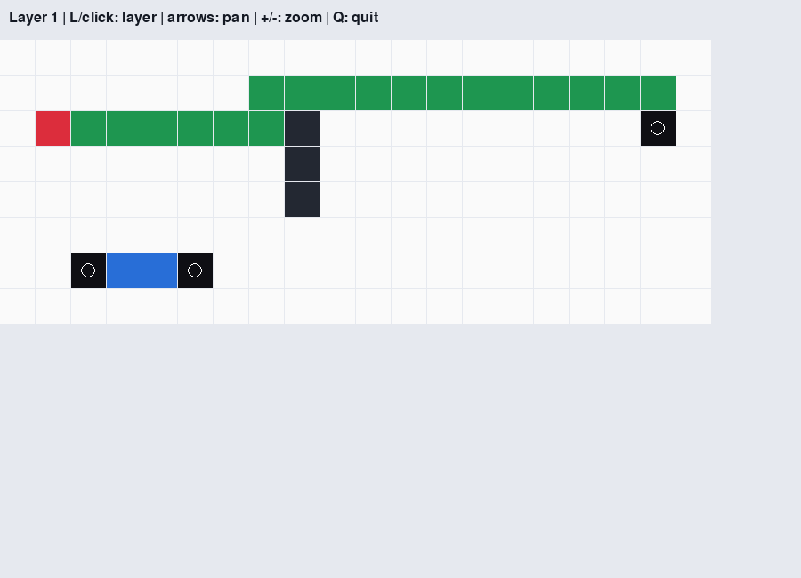

# Lee's Maze Router

A C++ router that connects circuit pins around obstacles on two layers, with weighted pathfinding and a Python/Pygame viewer.

[Quick start](#quick-start) · [Demo](docs/DEMO.md) · [Routing algorithm](docs/ALGORITHM.md) · [Input format](docs/FORMAT.md) · [Testing](docs/TESTING.md)

## Overview

In chip physical design, a route must connect pins while respecting occupied space and the cost of changing layers. This project models that problem as a weighted grid graph. Dijkstra search attaches pins to a growing connection tree, and a shared native core supplies both the CLI and the visualizer.

## Key features

- **Two-layer routing:** complementary preferred directions, configurable via costs and penalties for nonpreferred moves.
- **Multipin connections:** each additional pin attaches to its net's existing tree; other nets' pins and tracks remain reserved.
- **Explicit failure handling:** an unreachable net exports `UNROUTABLE` without committing partial tracks.
- **Bounded native input:** validated coordinates, input-size limits, positive movement costs and 64-bit path distances.
- **Independent verification:** shortest-path comparisons across 80 seeded boards, extension-state regressions and sanitizer CI.

## See it working



Actual output from the [rectangular fixture](tests/rectangular.txt), rerun on 30 October 2026:

```text
netA: ROUTED cost=51 cells=25
netB: ROUTED cost=23 cells=6
```

The image is an actual Pygame rendering of layer 1, revalidated against the unchanged renderer. The [demo walkthrough](docs/DEMO.md) explains the colors, the cost tradeoff and an unreachable-net example, with a captured CLI transcript.

## Tech stack

| Technology | Role |
|---|---|
| C++17 and the standard library | Parsing, ownership tracking, weighted search and route export |
| CMake and CTest | Shared core, CLI, optional module build and regression entry point |
| Python and pybind11 | Native-module access and independent test oracle |
| Pygame | Layer selection, zoom/pan and visible-cell rendering |
| GitHub Actions | Native, ASan/UBSan, extension and headless GUI jobs |

## Quick start

Requires a C++17 compiler, CMake 3.20+ and Python 3.10+ for the default test harness. From the repository root:

```bash
cmake -S . -B build -DCMAKE_BUILD_TYPE=Release
cmake --build build --parallel 2
./build/maze-router tests/rectangular.txt route-result.txt 10 10
ctest --test-dir build --output-on-failure
```

Use a fresh output path; existing files are rejected. The final two values are via cost and nonpreferred-direction cost, both defaulting to 10. See [build and GUI setup](docs/BUILD.md) for the Python module, viewer controls and platform notes.

## Design and evidence

The CLI and Python extension link to the same C++ implementation. Explicit predecessors reconstruct each accepted branch; a net's tracks are committed only after all of its pins connect. [Algorithm and architecture](docs/ALGORITHM.md) explains the ownership model, ordering heuristic and complexity.

The search is shortest-path optimal for each attachment on its current board. Sequential net ordering and pin order remain heuristics: the project does not guarantee a globally optimal multi-net solution or a minimum Steiner tree. It is a local educational VLSI tool; its routing model does not implement electrical design rules or network packet forwarding.

## Documentation

- [Build and GUI setup](docs/BUILD.md): prerequisites, extension configuration, controls and headless rendering.
- [Demo](docs/DEMO.md): real image, executed CLI output and cost interpretation.
- [Algorithm and architecture](docs/ALGORITHM.md): weighted search, state ownership and engineering tradeoffs.
- [Input/output format](docs/FORMAT.md): coordinates, file limits, output semantics and exit statuses.
- [Testing and limits](docs/TESTING.md): oracle coverage, sanitizer workflow and dated verification evidence.
- [Engineering review — 24 October 2026](docs/REVIEW.md): preserved findings and earlier remediation history.

## Team and provenance

An AUC CSCE 3304 team project by **Aly Elaswad, Mohamed Alaa and Omar Ganna** (Spring 2025). The original course report, historical fixtures and experimental `GUI` branch are retained. Individual ownership of the original team components is not established by this documentation.

No license grant is added. Collaborators must agree before choosing an open-source license; preserve team attribution and the original materials when contributing.
