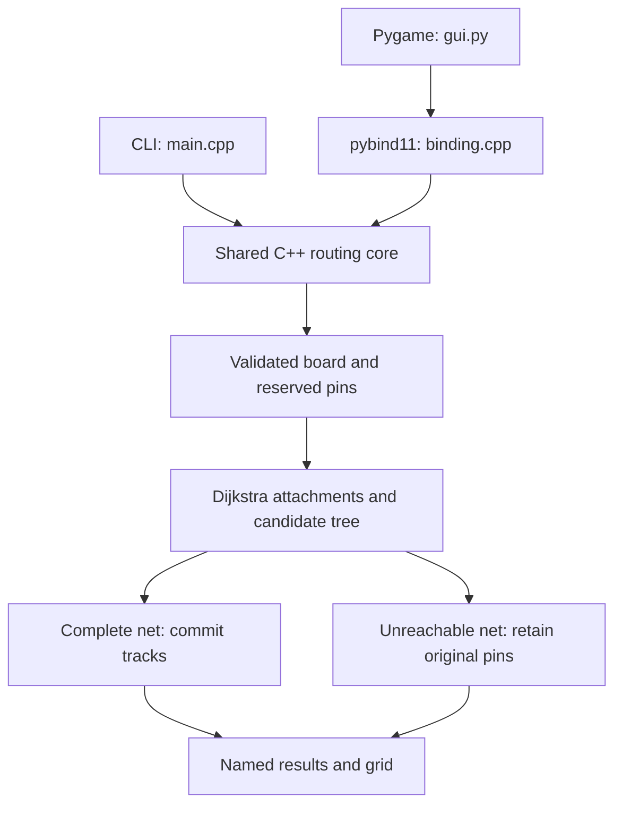

# Routing algorithm and architecture

[Overview](../README.md) · [Build](BUILD.md) · [Demo](DEMO.md) · [Format](FORMAT.md) · [Testing](TESTING.md)

## Shared native core

[functions.hpp](../src/functions.hpp) defines the shared grid and result types. [functions.cpp](../src/functions.cpp) implements parsing, routing and export; [main.cpp](../src/main.cpp) supplies the CLI contract. [binding.cpp](../src/binding.cpp) exposes the same implementation to [gui.py](../src/gui.py).

There are no separate routing algorithms to keep synchronized between the front ends. `get_results` returns per-net name, routed status, accumulated branch cost and cells; the grid/name-grid accessors support visualization.

## Board and ownership model

Each graph state is a layer and a grid location. Internal layers are 0 and 1; input/output layers are 1 and 2. Display storage is `[layer][x][y]`; the first input dimension is rows and the second is columns. See [FORMAT.md](FORMAT.md) for exact bounds.

The board's owner vector distinguishes obstacles (`-2`), free cells (`-1`) and a net index (`>=0`). All pins are reserved before any net is routed. A search may traverse free cells and cells owned by its own net; another net's pins/tracks are blocked. A via changes layers at the same x/y position and must satisfy the destination cell's ownership check.

## Weighted movement

| Move | Internal layer 0 / file layer 1 | Internal layer 1 / file layer 2 |
|---|---:|---:|
| Horizontal x step | 1 | Nonpreferred cost |
| Vertical y step | Nonpreferred cost | 1 |
| Change layer at the same x/y | Via cost | Via cost |

Costs are positive and bounded to 1–1,000,000. Distances use 64-bit integers. A min-priority queue drives Dijkstra relaxation; stale queue entries are ignored. Parents are recorded explicitly rather than inferred from neighboring distance values.

## Multipin tree construction

1. Parse the complete board and validate pin/obstacle conflicts.
2. Order nets by bounding-box span, then pin count, then original input index. This is deterministic, not congestion-aware optimization.
3. Start a net's candidate tree at its first input pin.
4. For each remaining pin in input order, initialize all current tree cells at distance zero and search for the target. Reconstruct the accepted branch through explicit parents.
5. Add that branch to the candidate tree. If every pin connects, commit the net's track ownership, display cells and result. If any attachment fails, discard the candidate tracks; original reserved pins remain.

Attaching to the whole current tree allows reuse of an existing same-net trunk. Reported cost is the sum of accepted attachment costs. Existing tree cells start at zero on later searches, so shared segments are not charged again. The exported cells form a unique connected set, not an ordered traversal of a branched tree.

A complete new grid/name-grid/result state replaces the prior extension state after successful output writing. Invalid input or a failed output operation does not publish a new result state. New output files can still be incomplete after a write failure; file creation is not an atomic filesystem transaction.

## Complexity and optimization limits

Let V = 2 × rows × columns and E ≤ 5V, since a state has at most four planar neighbors and one layer-change neighbor. Each attachment has O((V+E) log V) search time and O(V) search storage on this bounded-degree graph. Multipin nets repeat the search for successive targets.

Dijkstra finds a least-cost attachment on the currently available board. Net order and pin order are heuristics, so this does not guarantee a globally optimal multi-net arrangement or a minimum Steiner tree. Earlier committed nets can make later nets unreachable even when another overall arrangement might work.

The model omits rip-up/reroute, congestion negotiation, wire width/spacing, timing, electrical constraints and fabrication design rules. It is an educational physical-design router, not a complete chip-routing tool or a network packet router. No throughput or route-quality benchmark is claimed.

## Implementation map

| Concern | Source |
|---|---|
| Strict parsing, reservations and limits | `parse`, `Board` in [functions.cpp](../src/functions.cpp) |
| Multi-source shortest path and predecessors | `connect` in [functions.cpp](../src/functions.cpp) |
| Net ordering, commit/rollback and export | `readfile` in [functions.cpp](../src/functions.cpp) |
| Public types and native entry points | [functions.hpp](../src/functions.hpp) |
| CLI errors and exit codes | [main.cpp](../src/main.cpp) |
| Import-safe, bounded viewport | [gui.py](../src/gui.py) |
| Independent oracle and state regressions | [test_router.py](../tests/test_router.py), [test_binding.py](../tests/test_binding.py) |
